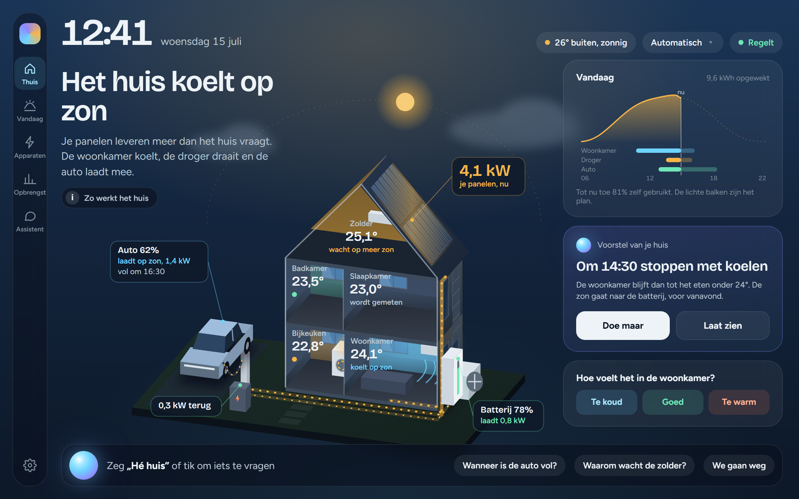
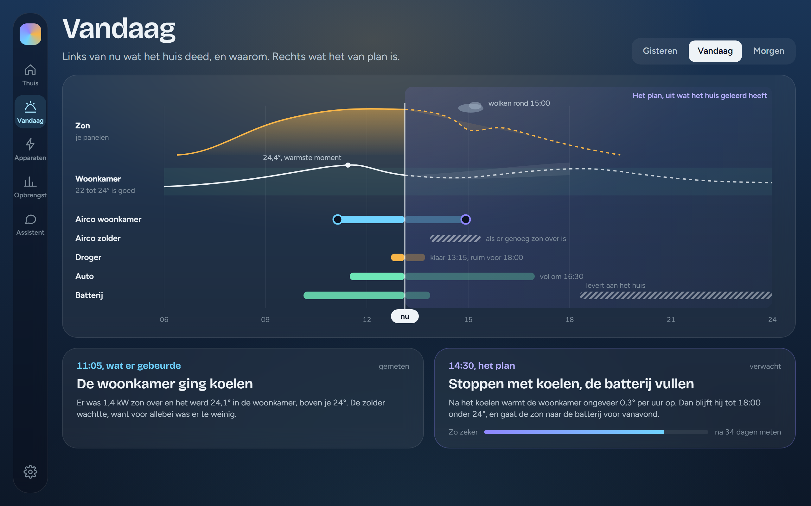
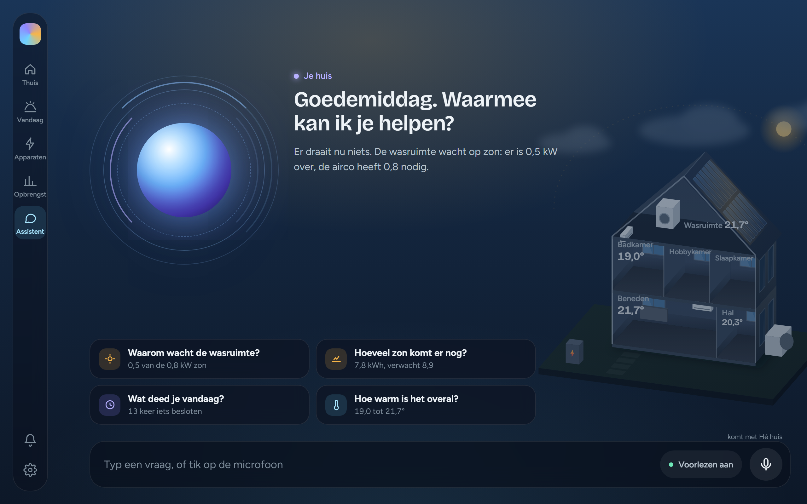
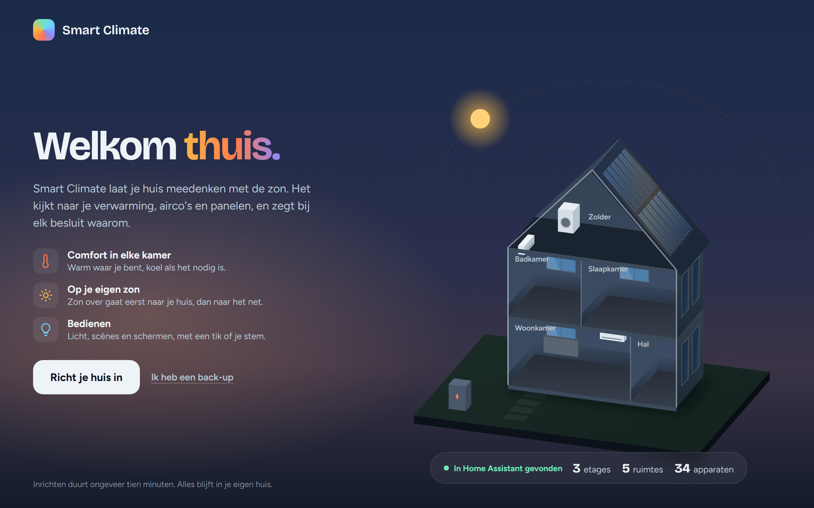
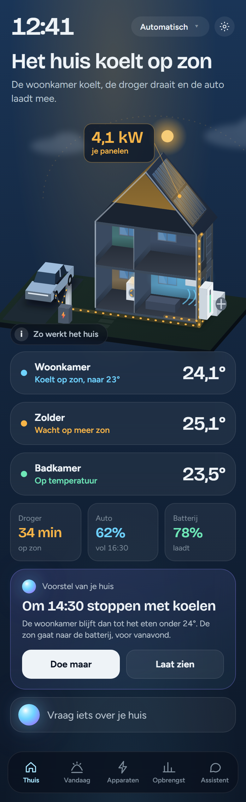

<p align="center"></p>

<h1 align="center">SunArc</h1>

<p align="center"><sub>AUTONOMOUS RESIDENTIAL CLIMATE</sub></p>

<p align="center"><b>Klimaat en zon in één app, voor Home Assistant.</b><br>
Je huis denkt mee met de zon: het kijkt naar je verwarming, airco's en zonnepanelen,<br>
en zegt bij elk besluit waarom.</p>

<p align="center"></p>

<p align="center"><sub>Beelden uit het ontwerp. Wat de app vandaag al doet en wat nog komt, staat hieronder.</sub></p>

---

## Wat is het?

SunArc is een add-on voor Home Assistant met een eigen app voor de tablet aan de muur en voor je telefoon. Het haalt je huis uit Home Assistant (etages, kamers, apparaten, sensoren) en tekent het als een opengewerkt poppenhuis. Daarin zie je in één oogopslag wat er gebeurt: waar het warm is, wat er draait en hoeveel zon je panelen leveren.

Achter de app zit een regeling die elke ronde beslist wat het huis zou moeten doen. Comfort eerst, en zon die over is, gaat naar je eigen huis voordat hij het net op gaat. Bij elk besluit staat waarom, in gewone taal.

**Eerlijk over de stand van nu:** SunArc kijkt mee. Het beslist en legt alles vast, maar schakelt je verwarming en airco's nog niet. Echt regelen komt pas na een volledige winter meekijken, met een bewijsrapport dat het beter doet dan je huidige regeling. Lampen, scènes en schermen bedien je wel al vanuit de app.

## Wat het kan

**Je huis in één beeld**
- Het huis in 3D, uit wat Home Assistant al weet. Je deelt het in per etage, kamer en zone.
- Per kamer de temperatuur, wat er warmt of koelt, en welke sensoren meetellen.
- Batterijen van sensoren en het filter van je airco, met een melding als het tijd is.

**Comfort en zon**
- Comfort per kamer en per dagdeel, en per bewoner: de eerste op volgorde die thuis is, bepaalt het comfort.
- Een stroombudget per fase, zodat je hoofdzekering het houdt.
- Wanneer de droger op zon zou starten, met een eindtijd die je zelf kiest.
- Het weer voor vandaag en vijf dagen, met wat je panelen dan leveren. Het huis leert hoeveel zon je dak bij heldere lucht vangt.

**Terugkijken**
- **Vandaag:** de dag in de tijd, met wat het huis deed en waarom.
- **Opbrengst** per dag, week, maand of jaar, met de prijzen van je eigen contract (normaal en dal, salderen en daarna).
- De zonverwachting naast wat er echt kwam.

**Bedienen en vragen**
- Lampen, Hue-scènes en schermen, met een tik.
- Camera's per kamer, en het beeld van de deurbel als er wordt aangebeld.
- **De assistent:** stel een vraag in je eigen woorden ("waarom wacht de zolder?"), en het huis antwoordt, hardop met de stem uit Home Assistant. Op de wand met "Hé huis", op de telefoon met de microfoon.

**Van jou**
- Alles draait in je eigen huis. Je gegevens gaan nergens heen; alleen het weerbericht wordt opgehaald.
- Inloggen gaat met je account van Home Assistant. Elke bewoner heeft een eigen plek, en een tablet aan de muur is gewoon een scherm.
- Een back-up van je instellingen in één klein bestand, en weer terugzetten.

<table>
<tr>
<td width="50%"></td>
<td width="50%"></td>
</tr>
<tr>
<td><sub><b>Vandaag</b>: wat het huis deed, en waarom.</sub></td>
<td><sub><b>De assistent</b>: vraag het je huis.</sub></td>
</tr>
<tr>
<td></td>
<td align="center"></td>
</tr>
<tr>
<td><sub><b>Welkom</b>: je huis groeit uit wat Home Assistant kent.</sub></td>
<td align="center"><sub><b>Op je telefoon</b>: dezelfde app.</sub></td>
</tr>
</table>

## Wat er nog komt

- **Echt regelen** van verwarming en airco's, na een winter meekijken met dertig winterdagen bewijs.
- Tarieven per uur en prognoses, en een thermisch model dat leert hoe je huis afkoelt en opwarmt.

Een thuisbatterij en een laadpaal laat SunArc zien, maar stuurt het niet zelf.

## Installeren

Je hebt Home Assistant met add-ons nodig (Home Assistant OS of Supervised), op een Raspberry Pi of een gewone pc (aarch64 of amd64).

1. Ga naar **Instellingen → Add-ons → Add-on store**. Kies rechtsboven de drie puntjes → **Repositories**, en voeg toe:
   ```
   https://github.com/Ricardo-switch/hems-climate
   ```
2. Kies **SunArc** → **Installeren**, en daarna **Starten**. Zet **In zijbalk tonen** aan.
3. Open SunArc in de zijbalk. Een nieuw huis begint met een welkom: je huis groeit uit wat Home Assistant kent, en met één knop ga je inrichten. Dat duurt ongeveer tien minuten.

Updates komen via Home Assistant. Zet op de add-on-pagina **Automatisch bijwerken** aan als dat vanzelf moet.

### Assist vraagt SunArc

Wil je SunArc ook vragen via Assist van Home Assistant ("waarom draait de zolder?", "wat doe je nu?"), dan heb je de integratie **SunArc** nodig. Geen YAML: de add-on meldt zich vanzelf aan.

- **Met HACS:** kies in HACS de drie puntjes → **Eigen repositories**, voeg `https://github.com/Ricardo-switch/hems-climate` toe als **Integratie**, installeer **SunArc** en herstart Home Assistant.
- **Zonder HACS:** open SunArc → **Instellingen → Bewoners en toegang → Sleutel voor de assistent** en tik op **Zet de integratie in Home Assistant**. Herstart daarna Home Assistant.

Home Assistant toont dan **Nieuw apparaat gevonden: SunArc**; klik op **Toevoegen**. Dat doe je één keer: een update van SunArc vraagt daarna geen herstart, want de zinnen en de antwoorden komen uit de add-on. De integratie heeft een eigen versie, die alleen omhoog gaat als hij zelf verandert. De integratie houdt de zinnen en de kamers van je huis zelf bij. Alles leest alleen: een opdracht als "koel de zolder naar 21" krijgt als antwoord wat SunArc zou doen.

Werkt het met jouw apparaten? SunArc werkt met wat je huis heeft. Een airco, een thermostaat, een slimme meter, panelen van elk merk: het doet wat jouw opstelling toelaat, en zegt bij **Wat je huis kan** wat het daardoor (nog) niet kan.

## Hoe het werkt

- **Een pure kern.** Strategieën doen elk een voorstel (comfort, warmte bijspringen, zon over), en één arbiter beslist binnen een budget aan vermogen. De kern doet geen in- of uitvoer en leest geen klok, dus elk besluit is na te rekenen.
- **Alles wordt vastgelegd.** Elk besluit, met de stand van het huis en de versie die het nam. Daar komt het bewijs voor het echte regelen uit.
- **Wat per huis verschilt, is een instelling**, niet code. Wat Home Assistant al weet, stelt de app voor; jij bevestigt.

Meer lezen:
- [STAND.md](STAND.md): per onderwerp hoe het nu werkt.
- [DECISIONS.md](DECISIONS.md): elk besluit, met waarom en wat het kostte.
- [Architecture.md](Architecture.md): de opbouw.
- [design/app2](design/app2): de schetsen van de app. De schets is de code: de app tekent het huis met dezelfde bestanden.

## Meebouwen

De dienst is TypeScript op Node 22, de app gewone HTML en JavaScript met Tailwind.

```bash
cd backend && npm ci && npm test
```

Het werk gaat naar `beta`. De CI controleert elke push (typecheck, lint, tests, de pagina in een browser en het image), en naar `main` gaat het alleen via een pull request. `main` is wat Home Assistant installeert.

## Licentie

SunArc is vrije software onder de [GNU Affero General Public License v3.0](LICENSE) (AGPL-3.0). Je mag het gebruiken, aanpassen en delen. Wie een aangepaste versie verspreidt, of hem als dienst of op een apparaat aanbiedt, deelt de broncode onder dezelfde licentie.

De naam SunArc en het teken vallen niet onder deze licentie.

Van anderen, elk met een eigen licentie:

- [qrcode-generator](https://github.com/kazuhikoarase/qrcode-generator) van Kazuhiko Arase, MIT: de QR-code bij Bewoners.
- De letters [Bricolage Grotesque](https://fonts.google.com/specimen/Bricolage+Grotesque) en [Figtree](https://fonts.google.com/specimen/Figtree), SIL Open Font License 1.1.
- De twee voorstappen van het wekwoord uit [openWakeWord](https://github.com/dscripka/openWakeWord) (`melspectrogram.onnx` en `embedding_model.onnx`), CC BY-NC-SA 4.0: niet voor commercieel gebruik.

---

<details>
<summary><b>In English</b></summary>

**SunArc** is a Home Assistant add-on with its own app for a wall tablet and your phone. It draws your home as a 3D dollhouse from what Home Assistant already knows, and decides around the clock what your heating, air conditioners and solar surplus should do, explaining every decision in plain words. Today it runs in *shadow mode*: it decides and records everything, but does not switch climate devices yet; lights, scenes and blinds can already be controlled from the app. Real control comes after a full winter of evidence. Everything runs locally. The app speaks Dutch and English.

Install: add `https://github.com/Ricardo-switch/hems-climate` as an add-on repository in Home Assistant and install **SunArc** (aarch64 and amd64).
</details>
